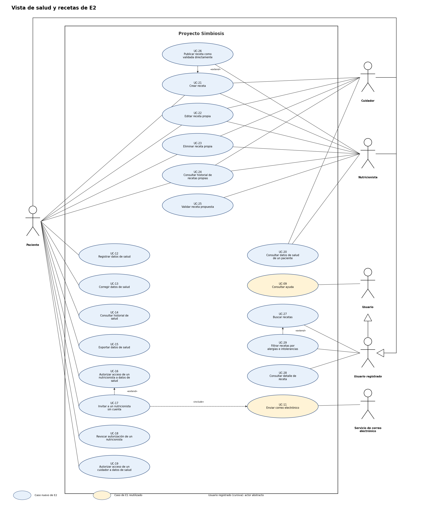

# Modelo de casos de uso de Proyecto Simbiosis

| Versión | Fecha | Estado |
| --- | --- | --- |
| 2.4 | 19/10/2026 | Revisado |

**Iteración de referencia:** E2. Este documento recoge el modelo acumulado después de incorporar la vista de salud y recetas.

**Plantilla base:** [Plantilla del modelo de casos de uso](plantilla-modelo-casos-de-uso.md). La plantilla se conserva sin cumplimentar. Los resultados del proyecto se incorporan a este documento.

Los diagramas representan distintas vistas del mismo modelo. Los nombres de los actores y los identificadores de los casos de uso se mantienen entre iteraciones.

## Índice

- [1 Alcance del modelo](#1-alcance-del-modelo)
- [2 Actores](#2-actores)
- [3 Casos de uso](#3-casos-de-uso)
- [4 Diagramas del modelo](#4-diagramas-del-modelo)
  - [4.1 Vista de acceso, cuentas y ayuda de E1](#41-vista-de-acceso-cuentas-y-ayuda-de-e1)
  - [4.2 Vista de salud y recetas de E2](#42-vista-de-salud-y-recetas-de-e2)
- [5 Respaldo en los requisitos](#5-respaldo-en-los-requisitos)
- [6 Descripciones de los casos de uso](#6-descripciones-de-los-casos-de-uso)
  - [6.1 Descripción detallada UC-05 — Actualizar perfil](#61-descripción-detallada-uc-05--actualizar-perfil)
  - [6.2 Descripción detallada UC-21 — Buscar recetas](#62-descripción-detallada-uc-21--buscar-recetas)
- [7 Continuidad entre iteraciones](#7-continuidad-entre-iteraciones)

## 1 Alcance del modelo

El modelo conserva la vista de acceso, cuentas y ayuda obtenida en E1. Incorpora una segunda vista con las funciones de salud y recetas seleccionadas en el apartado 4 del [plan de E2](../planificacion/plan-iteracion-e2.md). El alcance acumulado cubre parte de UR-01, UR-02, UR-03, UR-05, UR-06, UR-08, UR-12 y UR-13.

La vista de E1 incluye el registro y acceso local, la actualización del perfil, la eliminación de la cuenta propia, la autorización de relaciones de cuidado, la gestión básica de cuentas por el Coordinador, la ayuda y la bienvenida. La verificación del correo, la aprobación de la cuenta y la autorización de cada paciente son condiciones distintas.

E2 incorpora el registro y la corrección de datos de salud, la consulta del historial y la exportación. Incorpora también la autorización y la revocación del acceso de nutricionistas, la autorización del acceso de cuidadores y la consulta de los datos autorizados.

La vista de recetas incluye la gestión de recetas propias, la validación de recetas propuestas y la búsqueda de recetas. La búsqueda incluye los filtros seleccionados, la ordenación de resultados y la consulta del detalle de una receta seleccionada. La ayuda de E1 amplía sus temas. El envío de correo electrónico se reutiliza para invitar a un nutricionista que todavía no tiene cuenta.

La gestión de datos de salud agrupa el registro y la corrección de los datos que aporta el paciente. La consulta del historial y la exportación se mantienen como objetivos separados. La gestión de recetas propias agrupa la creación, la edición, la eliminación y la consulta del historial propio. La validación por un nutricionista se mantiene como otro objetivo porque cambia una propuesta pendiente a una receta publicada como validada.

El modelo mantiene una cobertura parcial de los ámbitos de E1 y E2. Quedan pendientes:

- El registro, el acceso y la vinculación con Google.
- El bloqueo temporal y la expulsión por infracciones, el fin de las relaciones de cuidado y la gestión automática de cuentas de cuidador sin pacientes.
- El foro, los consejos de vida saludable, los reportes y la moderación de contenidos. El uso del alias en esos espacios se estudiará al incorporarlos.
- La ayuda sobre funciones aún no representadas, el progreso entre sesiones, la multimedia y la búsqueda de temas.
- Los recordatorios, las alertas críticas y la gestión de umbrales de salud.
- La calculadora nutricional y las estadísticas completas de recetas.
- La ordenación por popularidad o calificación, las sugerencias, las recomendaciones y el historial de búsqueda.
- Las recetas favoritas, las listas, la lectura posterior, la descarga, la impresión y la compartición.
- Las notificaciones de nuevas recetas y las estadísticas de consulta.
- Las valoraciones, los comentarios de recetas y las funciones sociales relacionadas.
- Las reglas todavía abiertas sobre datos compartidos con cuidadores, propuestas pendientes, edición de recetas validadas y correspondencia entre alergias e ingredientes.

Los aplazamientos conservan los requisitos del proyecto. Una función representada en el modelo puede seguir pendiente de implementación.

## 2 Actores

Un actor representa un rol externo que interactúa con Proyecto Simbiosis. Una misma persona puede desempeñar más de un rol.

| Nombre del actor | Rol que representa |
| --- | --- |
| Usuario | Persona que interactúa con la plataforma. Este rol general permite representar funciones que no exigen una cuenta. |
| Usuario registrado | Persona que tiene una cuenta y utiliza las funciones comunes de los perfiles, como gestionar recetas propias o buscar recetas. La existencia de la cuenta no implica que haya iniciado sesión. |
| Paciente | Usuario registrado que autoriza sus relaciones de cuidado, gestiona sus datos de salud y controla qué cuidadores y nutricionistas pueden consultarlos. |
| Cuidador | Usuario registrado que solicita o mantiene relaciones de cuidado y puede consultar los datos de salud que un paciente le haya autorizado. |
| Nutricionista | Usuario registrado con perfil profesional sujeto a aprobación. Puede consultar datos autorizados y validar recetas propuestas. |
| Coordinador | Usuario registrado que consulta el listado de cuentas y aprueba, suspende o elimina cuentas dentro de sus permisos. |
| Servicio de correo electrónico | Sistema externo que presta el servicio de envío de mensajes de verificación, restablecimiento e invitación. |

**Generalizaciones.** Usuario registrado especializa a Usuario. Paciente, Cuidador, Nutricionista y Coordinador especializan a Usuario registrado. Cada actor especializado hereda la participación del actor general en sus casos de uso.

Usuario registrado se representa como actor abstracto para agrupar las funciones comunes de los perfiles. La generalización expresa roles, no una secuencia de registro o de inicio de sesión. Paciente y Cuidador no son roles excluyentes: FR-212 permite que una cuenta tenga ambos perfiles.

El Servicio de correo electrónico es un actor de apoyo y no pertenece a la jerarquía de usuarios. E2 no incorpora actores nuevos. Reutiliza los actores definidos en E1.

El registro de auditoría forma parte del comportamiento del sistema. No requiere un actor adicional ni una interacción directa del Coordinador con UC-35.

## 3 Casos de uso

Los objetivos de esta tabla son resúmenes. Las descripciones detalladas quedan pendientes en el apartado 6.

| Identificador | Nombre | Objetivo | Participantes |
| --- | --- | --- | --- |
| UC-01 | Registrar cuenta | Solicitar una cuenta local con los datos y las condiciones del perfil elegido. | Principal: Usuario. Apoyo: Servicio de correo electrónico, mediante UC-11. |
| UC-02 | Verificar correo electrónico | Confirmar la dirección de correo como condición para completar el registro. | Principal: Usuario. |
| UC-03 | Iniciar sesión | Establecer una sesión mediante las credenciales de una cuenta cuyo estado permita el acceso. | Principal: Usuario registrado. |
| UC-04 | Restablecer contraseña | Recuperar el acceso mediante un enlace enviado al correo de la cuenta. | Principal: Usuario registrado. Apoyo: Servicio de correo electrónico, mediante UC-11. |
| UC-05 | Actualizar perfil | Modificar los datos personales y las preferencias de la cuenta propia. | Principal: Usuario registrado. |
| UC-06 | Eliminar cuenta propia | Eliminar la cuenta propia tras comprobar la identidad con la contraseña actual. | Principal: Usuario registrado. |
| UC-07 | Autorizar relación de cuidado | Dar autorización expresa para activar una relación de cuidado concreta. | Principal: Paciente. |
| UC-09 | Consultar ayuda | Consultar las instrucciones y los temas de ayuda de las funciones seleccionadas. | Principal: Usuario. |
| UC-10 | Recorrer bienvenida | Conocer las funciones básicas mediante el recorrido del primer acceso, con la posibilidad de omitirlo. | Principal: Usuario registrado. |
| UC-11 | Enviar correo electrónico | Enviar el mensaje que necesita otro caso de uso. | Apoyo: Servicio de correo electrónico. No se asigna un actor principal independiente. |
| UC-12 | Gestionar datos de salud | Registrar datos fisiológicos, resultados de laboratorio o notas de salud, y corregir datos introducidos por error. | Principal: Paciente. |
| UC-13 | Consultar historial de salud | Consultar el historial de salud, filtrarlo por tipo de dato y acceder a sus gráficas. | Principal: Paciente. |
| UC-14 | Exportar datos de salud | Obtener los datos de salud propios en formato PDF o CSV. | Principal: Paciente. |
| UC-15 | Autorizar acceso de nutricionista a datos de salud | Conceder acceso a un nutricionista identificado, con correo verificado y verificación profesional completada. Si no tiene cuenta, enviarle una invitación sin conceder acceso. | Principal: Paciente. Apoyo: Servicio de correo electrónico, mediante la extensión de UC-11 cuando no existe la cuenta. |
| UC-16 | Revocar acceso de nutricionista a datos de salud | Retirar a un nutricionista una autorización concedida previamente. | Principal: Paciente. |
| UC-17 | Autorizar acceso del cuidador a datos de salud | Permitir que un cuidador con una relación activa consulte los datos de salud que el paciente decida compartir. | Principal: Paciente. |
| UC-18 | Consultar datos de salud autorizados | Consultar los datos de salud de un paciente dentro de la autorización vigente para ese participante. | Principal: Nutricionista o Cuidador. |
| UC-19 | Gestionar recetas propias | Crear recetas propias y proponerlas o publicarlas según el perfil; editar o eliminar las publicadas y consultar su historial. | Principal: Usuario registrado. |
| UC-20 | Validar receta propuesta | Revisar una receta propuesta por un paciente o cuidador y publicarla como validada cuando corresponda. | Principal: Nutricionista. |
| UC-21 | Buscar recetas | Buscar recetas mediante los criterios seleccionados, consultar los resultados y acceder al detalle de una receta. | Principal: Usuario registrado. |
| UC-31 | Aprobar cuenta de cuidador o nutricionista | Aprobar una cuenta solicitada con perfil de cuidador o nutricionista, conforme a las condiciones del perfil. | Principal: Coordinador. |
| UC-32 | Suspender cuenta de usuario activa | Suspender una cuenta de usuario que se encuentra activa. | Principal: Coordinador. |
| UC-33 | Eliminar cuenta de usuario | Eliminar una cuenta de usuario y conservar el contenido publicado cuando corresponda a un cuidador. | Principal: Coordinador. |
| UC-34 | Consultar listado de cuentas de usuario | Consultar las cuentas y su información básica: nombre, correo, rol y estado. | Principal: Coordinador. |
| UC-35 | Registrar acción en el historial de auditoría | Registrar la fecha, la hora y la acción realizada al aprobar, suspender o eliminar una cuenta. | Sin participación directa de un actor. Comportamiento incluido en UC-31, UC-32 y UC-33. |

UC-03 se representa como una subfunción de apoyo. Tener una sesión válida es una condición previa de las funciones protegidas. Esto no implica ejecutar UC-03 cada vez que se realiza una de ellas.

UC-04 requiere una cuenta, pero no una sesión iniciada. UC-02 representa la acción de verificar el correo; recibir el mensaje de UC-11 no equivale a verificarlo.

UC-07 y UC-17 representan autorizaciones diferentes. UC-07 aporta la autorización del paciente necesaria para activar una relación de cuidado. UC-17 permite consultar determinados datos de salud dentro de una relación activa. La primera autorización no concede automáticamente la segunda.

UC-12 no incluye la consulta completa del historial ni la exportación. Estos resultados corresponden a UC-13 y UC-14.

UC-15 y UC-16 distinguen la concesión y la revocación del acceso de un nutricionista. Si el correo indicado en UC-15 no corresponde a una cuenta, UC-11 añade el envío de una invitación. La invitación no concede acceso.

UC-18 tiene dos posibles actores principales. Cada uno consulta los datos autorizados para su rol y para el paciente concreto. El Paciente consulta sus propios datos mediante UC-13.

En UC-19, una receta propuesta por un paciente o cuidador queda pendiente de validación. Un nutricionista aprobado puede publicar directamente como validada una receta propia. UC-20 representa la validación posterior de una propuesta. FR-061 y FR-062 respaldan la edición y eliminación de recetas publicadas; no se deducen de ellos las reglas de modificación de propuestas pendientes.

UC-21 incorpora la selección y consulta del detalle de un resultado. El detalle no se representa como un caso de uso independiente en E2.

UC-31 a UC-35 conservan las decisiones de E1. UC-35 es una subfunción compartida y no representa una operación que el Coordinador inicie por separado.

La aprobación de la cuenta en UC-31 no sustituye la verificación del correo ni la autorización de cada paciente. UC-32 representa la suspensión administrativa seleccionada para E1; no incorpora sanciones por infracciones. UC-33 se distingue de UC-06: el Coordinador elimina una cuenta de usuario, mientras que en UC-06 el titular elimina su cuenta propia.

## 4 Diagramas del modelo

### 4.1 Vista de acceso, cuentas y ayuda de E1

**Frontera del sistema:** Proyecto Simbiosis.

**Alcance:** Registro y acceso local, condiciones por perfil, gestión básica de cuentas, ayuda contextual y bienvenida. La vista contiene siete actores y los quince casos de uso incorporados en E1.

**Relaciones entre casos de uso.** UC-01 y UC-04 incluyen UC-11. Ambos necesitan enviar un correo para completar el comportamiento previsto. Las flechas de inclusión apuntan desde cada caso base hacia UC-11. La participación del Servicio de correo electrónico se representa mediante su asociación con UC-11.

UC-31, UC-32 y UC-33 incluyen UC-35. Las flechas de inclusión apuntan desde cada uno de esos casos hacia UC-35. Cuando se realiza una de esas acciones administrativas, el sistema registra la fecha, la hora y el tipo de acción.

UC-34 no incluye UC-35. FR-185 exige auditar las acciones de aprobación, suspensión y eliminación. No exige registrar la consulta del listado.

La vista de E1 no utiliza relaciones de extensión ni generalizaciones entre casos de uso. La bienvenida y la ayuda tienen objetivos propios y se representan por separado.

### 4.2 Vista de salud y recetas de E2

**Frontera del sistema:** Proyecto Simbiosis.

**Alcance:** Gestión, consulta y exportación de datos de salud; acceso autorizado; gestión y validación de recetas; búsqueda de recetas y ayuda aplicable. La vista contiene seis actores y doce casos de uso. Reutiliza UC-09 y UC-11.

**Relaciones entre casos de uso.** UC-11 extiende UC-15 en el punto de extensión «Tras comprobar la cuenta». La extensión se aplica cuando el correo indicado no corresponde a una cuenta. El sistema envía una invitación mediante el Servicio de correo electrónico. El envío termina sin conceder acceso a los datos.

La flecha de extensión apunta desde UC-11 hacia UC-15, que es el caso base. El punto de extensión identifica el momento del recorrido; la condición «el nutricionista no tiene cuenta» determina cuándo se ejecuta el envío. No se envía una invitación en todas las autorizaciones. Cuando la condición se cumple, el envío forma parte del escenario y no implica una concesión de acceso.

Nutricionista y Cuidador se asocian directamente con UC-18. No se asocia UC-18 con Usuario registrado porque la existencia de una cuenta no concede acceso a los datos de un paciente.

La búsqueda de recetas se asocia con Usuario registrado conforme al acta de requisitos generales, §1.1. FR-119 exige además una sesión iniciada para la búsqueda avanzada y los resultados personalizados. La consulta del detalle seleccionado forma parte de UC-21.

## 5 Respaldo en los requisitos

Los identificadores remiten al [catálogo canónico de requisitos](../requisitos/catalogo-requisitos.md), versión 1.13, y a la [SRS](../requisitos/srs.md), versión 0.14. UR identifica un requisito de usuario; FR, un requisito funcional; NFR, un requisito no funcional. Las actas citadas son el [acta de UR-05](../captura/acta-captura-requisitos-ur-05.md), el [acta de requisitos generales](../captura/acta-captura-requisitos-generales.md) y el [acta de acuerdos técnicos y operativos](../captura/acta-acuerdos-tecnicos-operativos.md). Aportan acuerdos confirmados que todavía no siempre disponen de un FR específico.

| Elemento del modelo | UR y FR de referencia | NFR pertinentes | Relación con los requisitos |
| --- | --- | --- | --- |
| UC-01 Registrar cuenta | UR-01; FR-001, FR-002, FR-003, FR-004, FR-005, FR-007, FR-008, FR-011, FR-012, FR-013, FR-014, FR-188, FR-189, FR-191, FR-193, FR-213, FR-214 y FR-215 | NFR-010 | Registro local, alias único, validaciones, CAPTCHA y aceptaciones independientes. La solicitud profesional incluye el PDF y sus límites; la solicitud de cuidador permite indicar pacientes. |
| UC-02 Verificar correo electrónico | UR-01; FR-003, FR-009, FR-010 y FR-214 | NFR-010 | Confirmación del correo, registro de fecha y hora en UTC y mensajes sobre el estado del registro. No sustituye la aprobación del perfil ni la autorización de cuidado. |
| UC-03 Iniciar sesión | UR-02; FR-015 | NFR-004, NFR-005 y NFR-010 | Acceso local con correo y contraseña. E1 propone comprobar el rendimiento de este acceso; su asociación con NFR-005 sigue pendiente en el catálogo. |
| UC-04 Restablecer contraseña | UR-02; FR-016 | NFR-010 | Restablecimiento mediante un enlace enviado al correo de la cuenta, sin exigir una sesión iniciada. |
| UC-05 Actualizar perfil | UR-03; FR-019 | NFR-010 | Edición de datos personales y preferencias. El alias y el correo no se pueden modificar. |
| UC-06 Eliminar cuenta propia | UR-03; FR-020; UR-13; FR-211 | NFR-010 | Comprobación de la contraseña actual. El contenido publicado por un cuidador se conserva tras eliminar su cuenta. |
| UC-07 Autorizar relación de cuidado | UR-01; FR-193 y FR-194 | NFR-010 | Cada paciente autoriza su relación antes de que se active. Esta autorización no concede acceso automático a sus datos de salud. |
| UC-09 Consultar ayuda | UR-12; FR-172, parte de FR-173, FR-174, FR-175, FR-176 y FR-177 | NFR-010 | Ayuda sobre las funciones representadas. E2 amplía los temas con la búsqueda y la publicación de recetas, sin crear un objetivo nuevo. |
| UC-10 Recorrer bienvenida | UR-12; FR-207 | NFR-010 | Recorrido del primer acceso, que se puede omitir y es independiente de la ayuda contextual. |
| UC-11 y sus usos | UR-01, UR-02 y UR-05; FR-003 y FR-016; acta de UR-05, §2.6 | — | UC-01 y UC-04 incluyen el envío de mensajes de verificación y restablecimiento. UC-11 extiende UC-15 para enviar una invitación cuando el nutricionista no tiene cuenta. La invitación está respaldada por el acta y no tiene un FR propio. |
| UC-12 Gestionar datos de salud | UR-05; FR-041, FR-042 y FR-053; acta de UR-05, §§2.1 a 2.3 | NFR-010 | Registro manual de datos fisiológicos, laboratorio y notas. El acta confirma fechas, unidades, validaciones y corrección de datos introducidos por error. |
| UC-13 Consultar historial de salud | UR-05; FR-049, FR-050 y FR-216; acta de UR-05, §2.5 | NFR-004 y NFR-010 | Historial cronológico, filtro por tipo de dato y gráficas. |
| UC-14 Exportar datos de salud | UR-05; FR-047 y FR-048; acta de UR-05, §2.5 | NFR-010 | Exportación en PDF y CSV con el contenido precisado en el acta. |
| UC-15 Autorizar acceso de nutricionista a datos de salud | UR-05; FR-045 y FR-046; acta de UR-05, §2.6 | NFR-010 | El paciente identifica al nutricionista por correo. El acceso exige las verificaciones aplicables. Si no existe la cuenta, se envía una invitación que no concede acceso. |
| UC-16 Revocar acceso de nutricionista a datos de salud | UR-05; FR-198; acta de UR-05, §2.6 | NFR-010 | El paciente puede revocar en cualquier momento una autorización previa. El efecto sobre una consulta posterior debe impedir el acceso. |
| UC-17 Autorizar acceso del cuidador a datos de salud | UR-05; FR-201; condiciones de FR-193 y FR-194 | NFR-010 | El paciente selecciona los datos que comparte. La cuenta aprobada, la relación de cuidado activa y la autorización de datos son condiciones distintas. |
| UC-18 Consultar datos de salud autorizados | UR-05; FR-045, FR-046 y FR-201; condiciones de FR-193, FR-194, FR-198 y FR-208; acta de requisitos generales, §§2 y 7.1 | NFR-004 y NFR-010 | La consulta se respalda en las funciones de acceso autorizado. El nutricionista pierde el acceso tras la revocación; el cuidador, al terminar su asociación. El cuidador solo consulta los datos autorizados y no accede a dirección ni teléfono. |
| UC-19 Gestionar recetas propias | UR-06; FR-054 a FR-063, FR-066 y FR-204; condiciones de FR-191 y FR-192 | NFR-006 y NFR-010 | Creación, edición, eliminación e historial propio. Las propuestas de pacientes y cuidadores quedan pendientes; el nutricionista aprobado puede publicar directamente como validada una receta propia. El alias identifica al autor en el espacio público. |
| UC-20 Validar receta propuesta | UR-06; FR-204, FR-205 y FR-066; condición de FR-191; acta de acuerdos técnicos y operativos, §2.4.1 | NFR-006 y NFR-010 | Un nutricionista aprobado revisa la propuesta. Tras validarla, se publica como validada y muestra la insignia correspondiente. NFR-006 concierne a la publicación resultante; no fija el tiempo de la revisión humana. |
| UC-21 Buscar recetas | UR-08; FR-085 a FR-096, FR-099, FR-103 y FR-119 | NFR-004, NFR-005 y NFR-010 | Búsqueda por términos, ingredientes o autor; exclusiones, filtros, combinación de criterios, ordenación y resultados. FR-089 respalda la vista previa. E2 incorpora el detalle seleccionado como parte del recorrido, pero el catálogo no contiene un FR específico para esa consulta. |
| UC-31 Aprobar cuenta de cuidador o nutricionista | UR-13; FR-181; condición profesional de UR-01 en FR-191 | NFR-010 | El Coordinador aprueba cuentas de cuidador y nutricionista. La aprobación de la documentación profesional condiciona las funciones profesionales. |
| UC-32 Suspender cuenta de usuario activa | UR-13; FR-182 | NFR-010 | El Coordinador puede suspender cuentas de usuario activas. Los efectos concretos de la suspensión siguen pendientes de aclaración. |
| UC-33 Eliminar cuenta de usuario | UR-13; FR-183 y FR-211 | NFR-010 | El Coordinador puede eliminar cuentas. El contenido publicado por un cuidador se conserva tras eliminar su cuenta. |
| UC-34 Consultar listado de cuentas de usuario | UR-13; FR-184 | NFR-010 | El listado permite consultar todas las cuentas e incluye nombre, correo, rol y estado. |
| UC-35 y sus inclusiones desde UC-31, UC-32 y UC-33 | UR-13; FR-185 | — | El sistema registra la fecha, la hora y la acción cada vez que el Coordinador aprueba, suspende o elimina una cuenta. |
| Generalizaciones de actores | Roles de los UR; acta de requisitos generales, §§1 y 2; UR-13; FR-212 | — | Los actores especializados desempeñan también los roles generales y heredan sus asociaciones. FR-212 respalda específicamente que una cuenta pueda tener a la vez los perfiles de Paciente y Cuidador. |

FR-194 exige la autorización expresa de cada paciente antes de activar su relación de cuidado. UC-07 representa esa autorización. FR-201 exige otra autorización para acceder a los datos de salud y se representa mediante UC-17.

La invitación de UC-15 y la corrección incluida en UC-12 proceden del acta de UR-05. El modelo las identifica como acuerdos vigentes sin atribuirles un FR inexistente.

En UC-21, FR-089 exige la calificación promedio en la vista previa. Ese dato depende de las valoraciones de UR-11, que quedan fuera de E2. Registrar esta dependencia no incorpora al modelo las funciones de valoración ni declara que estén implementadas.

FR-192 exige mostrar el alias en los espacios públicos de recetas. FR-066 exige la insignia de validación. Ambas reglas se aplican al presentar las recetas en los casos correspondientes, incluida su consulta dentro de UC-21.

Las referencias a NFR-005 y NFR-006 relacionan las funciones con las mediciones previstas; no completan los vínculos pendientes en el catálogo. E2 selecciona la búsqueda y consulta de recetas y la publicación directa de una receta por un nutricionista aprobado para sus mediciones. Este documento no registra resultados de esas pruebas.

NFR-002, NFR-003, NFR-008, NFR-009 y NFR-014 condicionan los datos, la recuperación y los idiomas de la primera versión. NFR-011 a NFR-013 condicionan la plataforma y la arquitectura. Estas condiciones no originan casos de uso independientes ni quedan verificadas por el modelo.

## 6 Descripciones de los casos de uso

**Estado de la especificación.** Las descripciones detalladas de UC-05 y UC-21 están pendientes de elaboración. Las actas aprobadas definen el comportamiento acordado y delimitan el alcance de estas descripciones.

**Alcance de las descripciones.** Las actas aprobadas de UC-05 y UC-21, v1.1, complementan el catálogo y concretan el siguiente alcance:

UC-05 Actualizar perfil incluye la consulta y actualización de los datos personales, de contacto y de las preferencias dietéticas del perfil propio. El [acta de UC-05](../captura/acta-acuerdos-uc-05-actualizar-perfil.md) define los campos editables, la validación, el guardado, la cancelación y la respuesta ante fallos.

UC-21 Buscar recetas incluye la búsqueda de recetas, la presentación de resultados y la consulta del detalle de una receta seleccionada entre esos resultados. Este alcance está definido en el [plan de E2, apartado 4.4](../planificacion/plan-iteracion-e2.md#44-búsqueda-y-consulta-de-recetas) y en el [acta de UC-21](../captura/acta-acuerdos-uc-21-buscar-recetas.md).

Las actas constituyen la referencia para especificar esos comportamientos. UC-05 no modifica datos de salud. La descripción seleccionada de UC-21 es parcial y no aplica automáticamente las alergias del perfil. Las demás funciones conservan sus requisitos y siguen pendientes de descripción.

Las descripciones de UC-05 y UC-21 se limitan al comportamiento definido en sus actas aprobadas y siguen la estructura de la [plantilla base](plantilla-modelo-casos-de-uso.md#6-descripciones-de-los-casos-de-uso).

Los apartados 6.1 y 6.2 corresponden a las descripciones detalladas de UC-05 y UC-21.

### 6.1 Descripción detallada UC-05 — Actualizar perfil

**Identificador y nombre del caso de uso:** [Indica el caso.]

**Objetivo:** [Explica qué resultado pretende obtener el participante.]

**Participantes:** [Indica el actor principal y los actores de apoyo, si los hay.]

**Precondiciones:** [Indica qué se da por cumplido al comenzar. Las comprobaciones que realiza el sistema pertenecen al flujo.]

**Inicio:** [Indica qué acción o suceso inicia el caso.]

**Escenario principal de éxito:** [Describe la secuencia entre los participantes y el sistema.]

**Extensiones (flujos alternativos):** [Vincula cada variación a un paso. Indica cómo continúa o termina.]

**Postcondiciones:** [Indica qué queda establecido con éxito y qué se conserva o cambia si el caso termina sin éxito o se cancela. Una consulta no requiere modificar datos para alcanzar su objetivo.]

**Reglas y NFR pertinentes:** [Remite a los requisitos y actas que condicionan el comportamiento.]

**Preguntas abiertas:** [Registra solo las cuestiones necesarias que las fuentes no resuelvan. Si no hay preguntas para el alcance descrito, indícalo.]

### 6.2 Descripción detallada UC-21 — Buscar recetas

**Identificador y nombre del caso de uso:** [Indica el caso.]

**Objetivo:** [Explica qué resultado pretende obtener el participante.]

**Participantes:** [Indica el actor principal y los actores de apoyo, si los hay.]

**Precondiciones:** [Indica qué se da por cumplido al comenzar. Las comprobaciones que realiza el sistema pertenecen al flujo.]

**Inicio:** [Indica qué acción o suceso inicia el caso.]

**Escenario principal de éxito:** [Describe la secuencia entre los participantes y el sistema.]

**Extensiones (flujos alternativos):** [Vincula cada variación a un paso. Indica cómo continúa o termina.]

**Postcondiciones:** [Indica qué queda establecido con éxito y qué se conserva o cambia si el caso termina sin éxito o se cancela. Una consulta no requiere modificar datos para alcanzar su objetivo.]

**Reglas y NFR pertinentes:** [Remite a los requisitos y actas que condicionan el comportamiento.]

**Preguntas abiertas:** [Registra solo las cuestiones necesarias que las fuentes no resuelvan. Si no hay preguntas para el alcance descrito, indícalo.]

## 7 Continuidad entre iteraciones

E1 estableció la primera vista del modelo. Su estado revisado se conserva en el commit público `984a17f`, con los casos UC-01 a UC-07, UC-09 a UC-11 y UC-31 a UC-35.

La revisión de E1 sustituyó UC-08 Gestionar cuentas por cuatro objetivos del Coordinador y una subfunción de auditoría: UC-31 a UC-35. Esos códigos pertenecen a E1; su numeración no identifica una iteración.

E2 incorpora UC-12 a UC-21. Reutiliza UC-09 para ampliar la ayuda y UC-11 para enviar la invitación a un nutricionista sin cuenta. No modifica la primera vista.

Antes de publicar la solución de E2 se revisó su numeración. UC-15 representa la autorización del nutricionista y UC-16 representa su revocación. UC-17 a UC-21 se asignan de forma consecutiva al resto de los objetivos de acceso y recetas. La consulta del detalle se integró en UC-21 y no conserva un caso independiente. Estas asignaciones son las primeras que se incorporan al modelo revisado de E2.

UC-08 sigue retirado. Su código no se reutiliza. UC-22 a UC-30 no forman parte todavía de este estado del modelo; se incorporarán cuando se registre el resultado de E3.

El modelo acumulado contiene dos vistas, siete actores y veinticinco casos de uso vigentes. Los casos de E1 conservan sus identificadores. Las siguientes iteraciones mantendrán los elementos que conserven el mismo objetivo.

Git conserva las revisiones registradas del modelo y sus imágenes. La evaluación de cada iteración identificará el commit de su estado revisado, conforme a la [guía de modelos](README.md). Cerrar una iteración no declara automáticamente una línea base.
